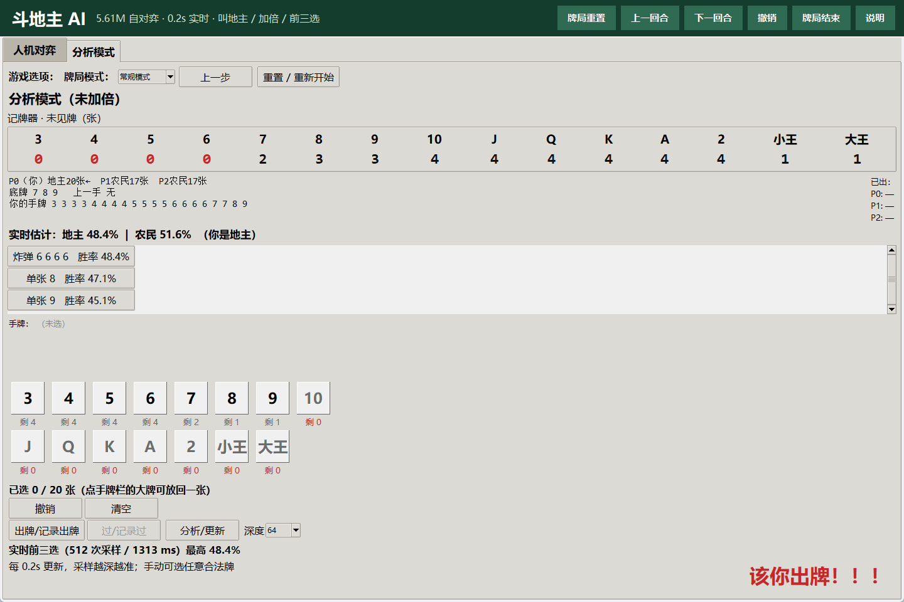
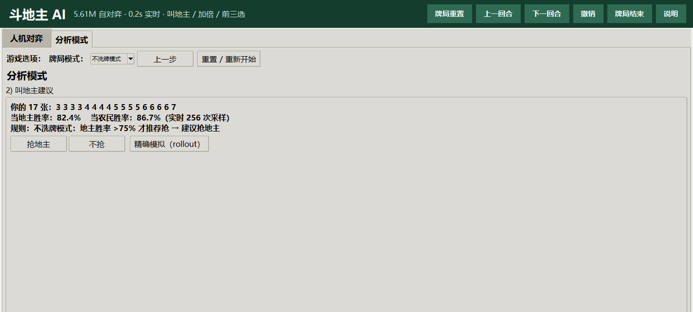
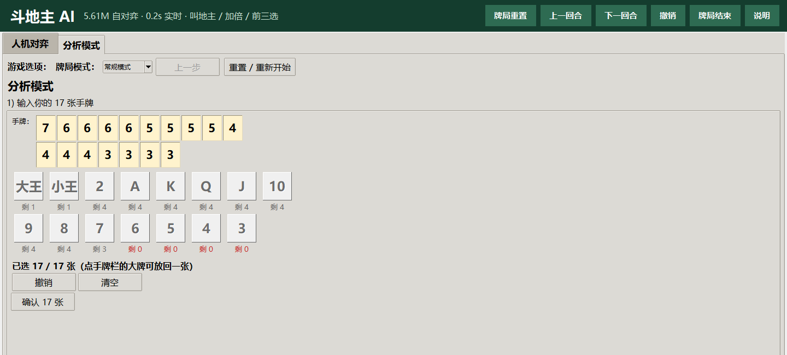
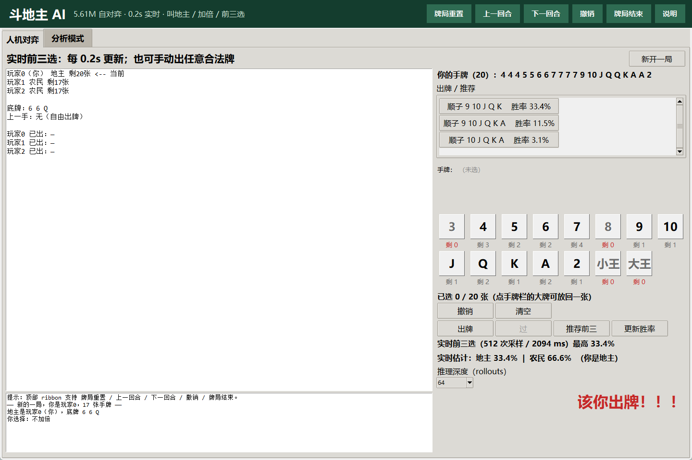

# 斗地主 AI

<p align="center">
  <b>本地自对弈 · 叫地主 / 加倍 / 前三选 · 常规 + 不洗牌双模式</b><br>
  <sub>Local self-play DouDizhu AI · bidding · doubling · anytime top-3 · regular & no-shuffle modes</sub>
</p>

<p align="center">
  <a href="README.md">简体中文</a> | <a href="README_EN.md">English</a>
</p>

<p align="center">
  
  
  
  
  
</p>

一个可以在本地直接运行的斗地主 AI 项目：包含**自对弈训练代码、两个可切换的分析模型、Tkinter 图形界面、评估脚本和测试**。模型只使用当前玩家可见的信息做决策，不读取对手手牌。

> 这是一个研究与娱乐项目，不是在线游戏外挂，也与腾讯 / 欢乐斗地主官方无关。

---

## 目录

- [特性](#特性)
- [界面预览](#界面预览)
- [快速开始](#快速开始)
- [两种分析模式](#两种分析模式)
- [模型与成绩](#模型与成绩)
- [技术方案](#技术方案)
- [训练与复现](#训练与复现)
- [常用命令](#常用命令)
- [项目结构](#项目结构)
- [已知限制](#已知限制)
- [AI 使用说明与致谢](#ai-使用说明与致谢)
- [License](#license)

---

## 特性

- **完整的三人斗地主规则**：单张、对子、三张、三带一/二、顺子、连对、飞机、四带二、炸弹、王炸、PASS。
- **26,064 个 rank 规范动作 + PASS**：去掉花色冗余，动作空间比朴素 54 张牌编码小得多。
- **动作打分 Q 网络**：状态 MLP + 15 步历史 LSTM + 动作 embedding/特征 + Q 头。
- **DMC 自对弈 + 对手池 + 启发式混合 + 检查点 soup**。
- **5.61M 残差 adapter 模型**：在 4.56M v2 上增加 1.05M adapter，最后一层零初始化，保证初始函数不变。
- **分析模式**：手动输入 17 张 → 叫地主 → 底牌/座位 → 加倍 → 逐手记录，实时给前三选和双方胜率。
- **不洗牌模式**：独立专家模型 + 独立胜率参数，不借用常规 bid net；重置后模式保持不变。
- **0.2s 级更新**：后台 anytime 搜索，4→8→…→512 次采样；1.2s 内先给可用前三选，之后继续加深。
- **纯本地**：推理不需要联网；模型权重随仓库提供。

## 界面预览

<p align="center">
  
  
</p>

<p align="center">
  <sub>左：分析模式（记牌器、双方实时胜率、前三选）；右：不洗牌模式（独立模型与 >75% 叫地主规则）</sub>
</p>

<p align="center">
  
  
</p>

## 快速开始

### 环境

- Python **3.11+**（开发环境为 3.12）
- Windows 10/11（GUI 使用 Tkinter；核心规则/训练代码可跨平台）
- GPU 可选：CUDA 显卡会明显加快分析与训练；CPU 也能运行
- 参考显卡：RTX 5070 Ti 16GB（Blackwell，需要 CUDA 12.8 轮子）

### 安装

```powershell
# 两个权重使用 Git LFS；先安装/启用 git-lfs（Git for Windows 自带）
git lfs install
git clone https://github.com/HitlightHU/doudizhu-ai.git Doudizhu
cd Doudizhu

python -m venv .venv
.\.venv\Scripts\activate

# 先按自己的 CUDA/CPU 安装 PyTorch；Blackwell 建议 cu128
pip install torch --index-url https://download.pytorch.org/whl/cu128

pip install -r requirements.txt
```

如果 Git LFS 在 VPN/代理下卡住，改用无 LFS 克隆 + 官方直链下载：

```powershell
$env:GIT_LFS_SKIP_SMUDGE=1
git clone https://github.com/HitlightHU/doudizhu-ai.git Doudizhu
cd Doudizhu
python scripts/download_weights.py
```

CPU 用户：

```powershell
pip install torch --index-url https://download.pytorch.org/whl/cpu
pip install -r requirements.txt
```

> `requirements.txt` 只包含运行依赖；训练/绘图/测试工具在 `requirements-dev.txt`。

### 启动

```powershell
python -m doudizhu.gui
```

Windows 也可以双击 `run_gui.bat`。

首次启动会加载两个模型、叫地主网络并预热 Numba/CUDA，约 10–30 秒。

## 两种分析模式

分析模式顶部：

```text
游戏选项： 牌局模式：[常规模式 ▼]  上一步  重置 / 重新开始
```

- **常规模式**：默认 5.61M adapter，常规叫地主规则：
  - 地主胜率 > 农民胜率；或
  - 地主胜率 > 70%；或
  - 地主胜率低于农民不超过 5%。
- **不洗牌模式**：
  - 使用 `best_model_noshuffle.pt` 专家；
  - **初始叫地主、实时叫地主、前三选、双方胜率、加倍全部使用专家模型自己的参数**，不使用常规 `bid_net`；
  - **只有地主胜率 > 75% 才推荐抢**（严格大于，75% 本身不推荐）；
  - 重置/牌局结束后**模式保持不变**。

分析流程本身仍是手动输入：17 张 → 叫地主 → 底牌/座位 → 加倍 → 出牌。  
人机对弈使用常规发牌和常规模型。

### 不洗牌发牌规则

公开资料（[欢喜斗地主规则](https://ddz.qileyx.com/content/227258)、[QQ 游戏玩法说明](https://ol.gamersky.com/news/201904/1172025.shtml)）只说明“上一局不洗牌，切牌后按顺序发 17/17/17+3”，没有公开完整服务端实现。本项目采用一套明确、可复现的本地规则：

1. 首局随机牌堆；
2. 按本局实际出牌顺序记录每一手，保留组内结构；
3. 局末接三家剩余手牌（各自按点数排序），得到 54 张；
4. 随机切牌（循环移位，保留相对顺序）；
5. 连续取 17/17/17 三份，随机分给三个座位，最后 3 张底牌。

本地实测约 **1.6 个炸弹/手**，普通随机约 0.06；首局仍随机，不保证每局都多炸弹。  
这**不是**对官方内部算法的逐字节复刻。

## 模型与成绩

### 常规模式：1024 副固定发牌

| 对手 | 总胜率 | 地主 | 农民 |
|---|---:|---:|---:|
| 随机出牌 | **0.958** | 0.973 | 0.951 |
| 贪心 bot | **0.814** | 0.814 | 0.813 |
| 启发式 bot（单座） | **0.657** | 0.768 | 0.602 |
| 启发式 bot（整方） | **0.770** | 0.767 | 0.772 |
| 启发式 bot + oracle 地主 | **0.578** | 0.908 | 0.413 |

> 以上是模型对脚本 bot 的实测，**不是对人类胜率**。

### 不洗牌模式：256 个不洗牌牌局 / 768 局

| 模型 | 总胜率 | 地主 | 农民 |
|---|---:|---:|---:|
| 常规 adapter | 0.5625 | 0.4375 | 0.6250 |
| **不洗牌专家** | **0.6549** | **0.5898** | **0.6875** |

同牌局整方头对头（512 局，无 bot，地主/农民互换）：

| 一方 | 胜率 |
|---|---:|
| 常规 adapter | 0.3613 |
| **不洗牌专家** | **0.6387** |

### 权重

| 文件 | 用途 | 参数 |
|---|---|---:|
| `checkpoints/best_model.pt` | 常规模式默认 | 5.61M |
| `checkpoints/best_model_noshuffle.pt` | 不洗牌分析模式专用 | 5.61M |
| `checkpoints/bid_net.pt` | 常规模式叫地主先验 | 小网络 |

权重是**推理所需的最小 state_dict**，不包含 optimizer；以 **FP16 存储（每个 11.2MB），加载时转回 FP32 推理**。  
两个权重通过 **Git LFS** 存放；克隆前先 `git lfs install`。完整指标见
[`checkpoints/model_info.json`](checkpoints/model_info.json) 和 [模型卡](checkpoints/README.md)。

## 技术方案

```text
状态特征 (132) ──► MLP ──┐
历史 (15 × 33) ──► LSTM ──┴─► 状态向量 z
动作 ID + 13 维特征 ──► embedding/MLP ──┐
                                        ├─► Q(s, a)
z ──────────────────────────────────────┘
```

- **动作空间**：按点数/链长/带牌规范化的 26,064 个动作 + PASS；牌用 54-bit mask 表示。
- **状态**：自己手牌、已出牌、底牌、三家剩余张数、上一手、PASS 数、地主/农民身份、历史动作。
- **训练**：DMC 自对弈；对手池 + 启发式 bot 混合；oracle 地主分配退火到随机分布。
- **v2**：从 v1 继续 656 万局，3 检查点 soup。
- **adapter**：v2 + 1.05M 残差 MLP（512→1024→512），最后层零初始化，继续 133 万局。
- **不洗牌专家**：从 5.61M adapter 继续 80 iter（约 131 万局），专用于不洗牌分布。

## 训练与复现

```powershell
# 从零/小规模自对弈（默认配置）
python -m doudizhu.train --config configs/default.yaml

# 不洗牌专家（从发布权重继续）
python -m doudizhu.train --config configs/noshuffle3_20261031.yaml ^
  --resume checkpoints/best_model.pt
```

训练日志默认写到 `runs/<name>/`，已在 `.gitignore` 中排除。  
详细训练配置、评估协议和结果见 [训练报告](docs/TRAINING.md)。

## 常用命令

```powershell
# 常规完整评估
python scripts/final_eval.py --model checkpoints/best_model.pt --games 1024

# oracle 地主评估
python scripts/eval_oracle.py --model checkpoints/best_model.pt ^
  --bid-net checkpoints/bid_net.pt --games 512

# 不洗牌模式对照
python scripts/eval_noshuffle.py --deals 256

# 不洗牌整方头对头
python scripts/head_noshuffle.py --deals 256

# anytime 延迟
python scripts/bench_anytime.py --n 32

# 规则与 GUI 回归
python tests/test_rules.py
python scripts/gui_mode_test.py
```

## 项目结构

```text
Doudizhu/
├─ doudizhu/            # 规则、Numba 引擎、网络、分析、GUI、训练
├─ checkpoints/         # 发布权重 + 模型卡 + 评估 JSON
├─ configs/             # 默认训练、不洗牌训练
├─ scripts/             # 评估、基准、GUI 回归测试
├─ tests/               # 规则/动作空间测试
├─ docs/                # GUI 说明、训练报告、截图
├─ requirements.txt     # 运行依赖
├─ requirements-dev.txt # 训练/绘图依赖
├─ run_gui.bat
└─ README.md / README_EN.md
```

## 已知限制

- **没有人类对局评测**。表中的胜率都是对脚本 bot，不能直接当作人类胜率。
- **“1.2s 内 99% 最优”是工程口径**：1.2s 内先给 128 样本 top-3（实测 32/32），之后继续到 512；不是博弈论最优性证明。
- **不洗牌规则是本地近似**：官方未公开完整收牌/切牌实现。
- **没有做搜索蒸馏**：本轮优先完成更大模型、对手池、adapter 和不洗牌专家；把 512 样本搜索值蒸馏回 Q 网络是后续方向。
- **GPU 利用率不高**：自对弈发牌/规则在 CPU，训练时 GPU 约 10–30%；吞吐约 1300–1400 局/秒。
- 动作空间和规则按标准三人斗地主实现；不同平台的癞子/天地癞子等玩法不包含。

## AI 使用说明与致谢

### AI 使用说明

本项目的代码、训练脚本、GUI、评估与文档在开发过程中使用了 **AI 编程助手（DeepSeek Harness / DeepSeek）** 辅助生成和修改。  
所有训练、评估、GUI 启动和测试均在本地实际执行；模型通过自对弈学习，**没有使用人类牌谱**。  
AI 生成内容已做人工审查，但仍可能存在错误，欢迎通过 Issue 指出。

### 致谢

- **DouZero**（Kwai）— DMC 自对弈、对手池和动作价值网络方向的重要开源工作，本项目受其启发；未直接复制其代码或权重。
- **PyTorch / NumPy / Numba / Tkinter** — 训练、数值计算、批量规则引擎和 GUI。
- **QQ 游戏 / 欢乐斗地主** 的公开“不洗牌”玩法说明 — 仅作为规则参考，本项目与其无关联。
- 所有开源社区贡献者。

### 免责声明

本项目仅用于学习、研究和本地娱乐；请勿用于在线游戏作弊、商业代练或其他违反平台规则的行为。  
项目中“斗地主”相关名称仅用于说明玩法，不代表与任何官方平台存在合作或授权关系。

## License

[MIT](LICENSE)
