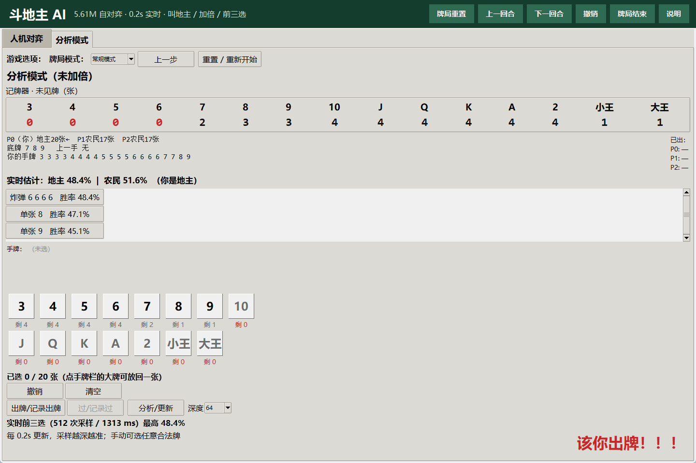
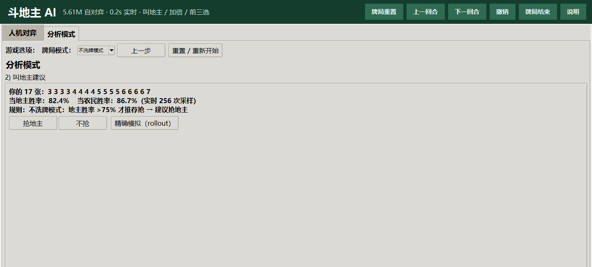
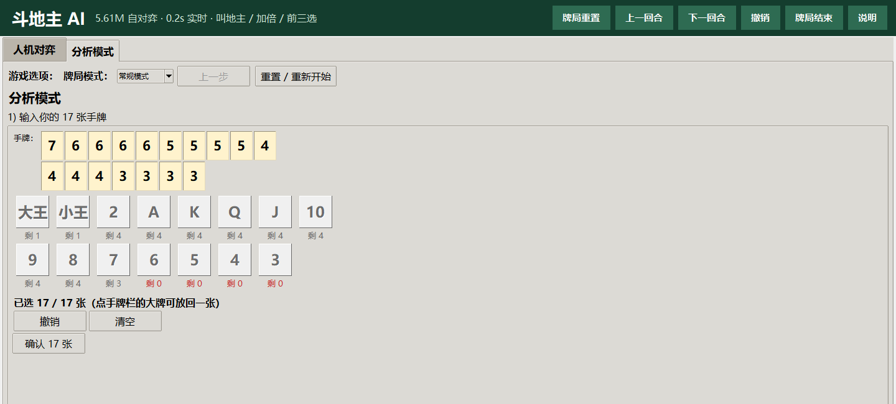
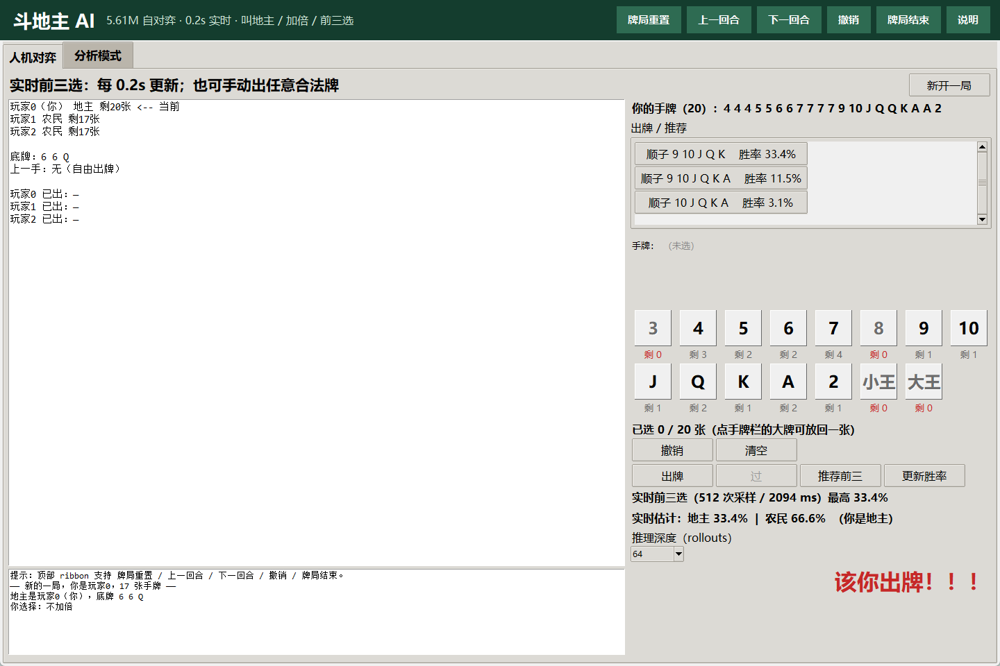

# Doudizhu AI

<p align="center">
  <b>Local self-play DouDizhu · bidding / doubling / anytime top-3 · regular & no-shuffle modes</b><br>
  <sub>本地自对弈斗地主 · 叫地主 / 加倍 / 前三选 · 常规与不洗牌双模式</sub>
</p>

<p align="center">
  <a href="README.md">简体中文</a> | <a href="README_EN.md">English</a>
</p>

<p align="center">
  
  
  
  
  
</p>

A fully local DouDizhu AI project with **self-play training code, two selectable analysis models, a Tkinter GUI, evaluation scripts and regression tests**. The models only use information visible to the current player; opponent hands are never fed into the network.

> Research / entertainment project. Not an online-game cheat, and not affiliated with Tencent or any official DouDizhu platform.

---

## Contents

- [Features](#features)
- [Screenshots](#screenshots)
- [Quick start](#quick-start)
- [Analysis modes](#analysis-modes)
- [Models and results](#models-and-results)
- [Architecture](#architecture)
- [Training](#training)
- [Commands](#commands)
- [Project layout](#project-layout)
- [Limitations](#limitations)
- [AI disclosure and acknowledgements](#ai-disclosure-and-acknowledgements)
- [License](#license)

## Features

- Full three-player DouDizhu rules: singles, pairs, trios, trio attachments, straights, pair straights, airplanes, four-with-two, bombs, rocket, PASS.
- **26,064 rank-canonical actions + PASS**, represented as 54-bit masks.
- Action-value Q network: state MLP + 15-step history LSTM + action embedding/features + Q head.
- DMC self-play, opponent league, heuristic mixing and checkpoint soup.
- **5.61M residual adapter model**: 4.56M v2 backbone + 1.05M adapter, zero-initialized last layer.
- **Analysis mode**: enter 17 cards → bid advice → bottom cards/seat → double advice → play-by-play top-3 and both-camp win rates.
- **No-shuffle mode**: dedicated expert model and dedicated win-rate parameters; does not reuse the regular bid net; mode survives reset.
- **~0.2s UI updates**: background anytime search, 4→8→…→512 samples; usable top-3 before 1.2s and deeper search afterwards.
- **Local inference**: no network needed; weights are included.

## Screenshots

<p align="center">
  
  
</p>

<p align="center">
  <sub>Left: analysis mode (card counter, both-camp win rates, top-3). Right: no-shuffle mode (dedicated model and >75% bid rule).</sub>
</p>

<p align="center">
  
  
</p>

## Quick start

### Requirements

- Python **3.11+** (developed on 3.12)
- Windows 10/11 for the Tkinter GUI; core rules/training are cross-platform
- Optional CUDA GPU; CPU works but is slower
- Reference GPU: RTX 5070 Ti 16GB (Blackwell, CUDA 12.8 wheels)

### Install

```powershell
git clone https://github.com/HitlightHU/doudizhu-ai.git Doudizhu
cd Doudizhu

python -m venv .venv
.\.venv\Scripts\activate

# Install PyTorch for your own CUDA/CPU first; cu128 for Blackwell
pip install torch --index-url https://download.pytorch.org/whl/cu128

pip install -r requirements.txt
```

CPU-only:

```powershell
pip install torch --index-url https://download.pytorch.org/whl/cpu
pip install -r requirements.txt
```

> `requirements.txt` contains runtime dependencies only. Training/plotting tools are in `requirements-dev.txt`.

### Run

```powershell
python -m doudizhu.gui
```

On Windows you can also double-click `run_gui.bat`.

The first launch loads both models and the bid net, and warms up Numba/CUDA; expect 10–30 seconds.

## Analysis modes

At the top of analysis mode:

```text
牌局模式：[常规模式 ▼]  上一步  重置 / 重新开始
```

- **Regular mode**: 5.61M adapter; bid rule:
  - landlord win rate > farmer win rate; or
  - landlord win rate > 70%; or
  - landlord win rate is at most 5% below farmer.
- **No-shuffle mode**:
  - uses `best_model_noshuffle.pt`;
  - **initial bid, live bid, top-3, both-camp win rates and double advice all use the no-shuffle model's own parameters**, never the regular `bid_net`;
  - **only recommends grabbing when landlord win rate > 75%** (strictly greater);
  - mode persists after reset / game end.

The analysis workflow is still manual input: 17 cards → bid → bottom/seat → double → play.  
Human-vs-AI mode uses regular deals and the regular model.

### No-shuffle deal rule

Public descriptions ([Happy DouDizhu rules](https://ddz.qileyx.com/content/227258), [QQ Games overview](https://ol.gamersky.com/news/201904/1172025.shtml)) only state that the 54 cards are not reshuffled, cut, then dealt 17/17/17+3. The full server algorithm is not public. This project uses a reproducible local rule:

1. random deck for the first game;
2. record every played group in actual play order;
3. append the three remaining hands (sorted by rank), giving 54 cards;
4. randomly cut (cyclic shift, preserving relative order);
5. take three consecutive 17-card blocks and randomly assign the blocks to seats; last 3 cards are the bottom.

Measured about **1.6 bombs/hand** locally vs about 0.06 for a normal random deal. The first game is still random; not every game is bomb-heavy. This is **not** a byte-for-byte replica of any official server.

## Models and results

### Regular model — 1024 fixed deals

| Opponent | Overall | Landlord | Farmer |
|---|---:|---:|---:|
| Random | **0.958** | 0.973 | 0.951 |
| Greedy bot | **0.814** | 0.814 | 0.813 |
| Heuristic bot (one seat) | **0.657** | 0.768 | 0.602 |
| Heuristic bot (full side) | **0.770** | 0.767 | 0.772 |
| Heuristic bot + oracle landlord | **0.578** | 0.908 | 0.413 |

> These are results against scripted bots, **not human win rates**.

### No-shuffle mode — 256 deals / 768 games

| Model | Overall | Landlord | Farmer |
|---|---:|---:|---:|
| Regular adapter | 0.5625 | 0.4375 | 0.6250 |
| **No-shuffle expert** | **0.6549** | **0.5898** | **0.6875** |

Full-side head-to-head on the same deals (512 games, no bots, landlord/farmer swapped):

| Side | Win rate |
|---|---:|
| Regular adapter | 0.3613 |
| **No-shuffle expert** | **0.6387** |

### Weights

| File | Purpose | Params |
|---|---|---:|
| `checkpoints/best_model.pt` | regular default | 5.61M |
| `checkpoints/best_model_noshuffle.pt` | no-shuffle analysis expert | 5.61M |
| `checkpoints/bid_net.pt` | regular-mode bid prior | small MLP |

Weights are minimal inference-only state dicts (no optimizer), stored in **FP16 (11.2MB each) and loaded as FP32**. Full metrics are in
[`checkpoints/model_info.json`](checkpoints/model_info.json) and the [model card](checkpoints/README_EN.md).

## Architecture

```text
state features (132) ──► MLP ──┐
history (15 × 33) ──► LSTM ────┴─► state vector z
action ID + 13 features ──► embedding/MLP ──┐
                                             ├─► Q(s, a)
z ───────────────────────────────────────────┘
```

- **Action space**: rank-canonical actions with type/chain/attachments + PASS.
- **State**: own hand, played cards, bottom cards, hand sizes, last action, passes, role, history.
- **Training**: DMC self-play, opponent league, heuristic mixing, oracle-to-random landlord annealing.
- **v2**: 6.56M extra games from v1, 3-checkpoint soup.
- **adapter**: v2 + 1.05M residual MLP (512→1024→512), zero-initialized last layer, 1.33M extra games.
- **No-shuffle expert**: 80 iterations (~1.31M games) from the 5.61M adapter, dedicated to the no-shuffle distribution.

## Training

```powershell
# Default self-play (small/default config)
python -m doudizhu.train --config configs/default.yaml

# No-shuffle expert (continue from the release weights)
python -m doudizhu.train --config configs/noshuffle3_20261031.yaml ^
  --resume checkpoints/best_model.pt
```

Logs go to `runs/<name>/` (git-ignored). See [TRAINING_EN.md](docs/TRAINING_EN.md).

## Commands

```powershell
# Full regular evaluation
python scripts/final_eval.py --model checkpoints/best_model.pt --games 1024

# Oracle-landlord evaluation
python scripts/eval_oracle.py --model checkpoints/best_model.pt ^
  --bid-net checkpoints/bid_net.pt --games 512

# No-shuffle comparison
python scripts/eval_noshuffle.py --deals 256

# Full-side no-shuffle head-to-head
python scripts/head_noshuffle.py --deals 256

# Anytime latency
python scripts/bench_anytime.py --n 32

# Rules and GUI regression
python tests/test_rules.py
python scripts/gui_mode_test.py
```

## Project layout

```text
Doudizhu/
├─ doudizhu/            # rules, Numba engine, network, analysis, GUI, training
├─ checkpoints/         # released weights, model card, evaluation JSON
├─ configs/             # default and no-shuffle training configs
├─ scripts/             # evaluation, benchmarks, GUI regression tests
├─ tests/               # rules/action-space tests
├─ docs/                # GUI guide, training report, screenshots
├─ requirements.txt     # runtime dependencies
├─ requirements-dev.txt # training/plotting dependencies
├─ run_gui.bat
└─ README.md / README_EN.md
```

## Limitations

- **No human evaluation.** Bot results are not human win rates.
- **“99% optimal within 1.2s” is an engineering target**: a usable 128-sample top-3 within 1.2s (32/32 measured), then deeper search to 512; not a game-theoretic optimality proof.
- **No-shuffle implementation is a local approximation**; the official server algorithm is not public.
- **No search distillation yet.** Search-guided training of the Q network is the next direction.
- **Low GPU utilization**: self-play dealing/rules run on CPU; training GPU utilization is roughly 10–30%, at ~1,300–1,400 games/s.
- Standard three-player DouDizhu only; laizi / variant modes are not included.

## AI disclosure and acknowledgements

### AI disclosure

AI coding assistants (**DeepSeek Harness / DeepSeek**) were used to help write and modify code, training scripts, GUI and documentation. All training, evaluation, GUI launches and tests were executed locally. The models learn from self-play and **do not use human game logs**. AI-assisted content was reviewed, but mistakes may remain; issues are welcome.

### Acknowledgements

- **DouZero** (Kwai) — inspiration for DMC self-play, opponent league and action-value learning. No code or weights from DouZero are included.
- **PyTorch / NumPy / Numba / Tkinter** — training, numerics, batched rules engine and GUI.
- **QQ Games / Happy DouDizhu** public descriptions of the no-shuffle mode — rule reference only; no affiliation.
- The open-source community.

### Disclaimer

For learning, research and local entertainment only. Do not use it to cheat in online games or violate platform rules. “DouDizhu” is used descriptively; this project is not endorsed by or affiliated with any official platform.

## License

[MIT](LICENSE)
