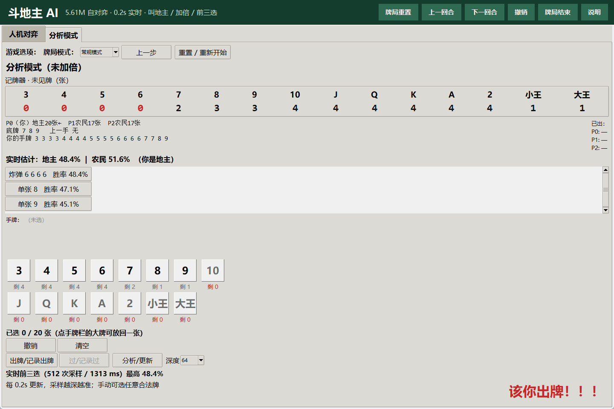
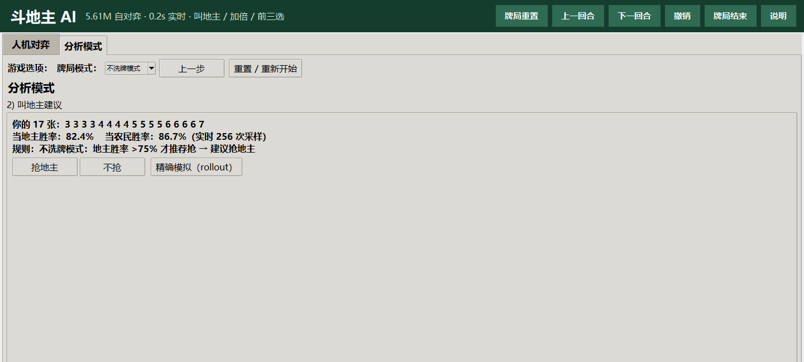
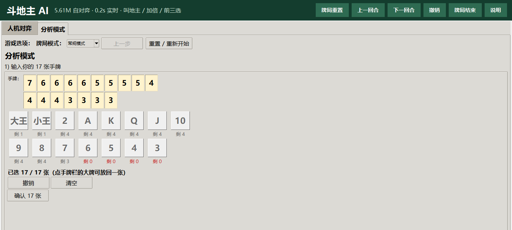

# GUI 使用说明

[简体中文](GUI.md) | [English](GUI_EN.md)

启动：

```powershell
python -m doudizhu.gui
```

或双击仓库根目录的 `run_gui.bat`。首次启动会加载两个模型、叫地主网络并预热 Numba/CUDA，约 10–30 秒。



---

## 1. 顶部 ribbon

| 按钮 | 作用 |
|---|---|
| **牌局重置** | 人机：新开一局；分析：回到本局出牌开始（保留已输入的 17 张/底牌） |
| **上一回合** | 按动作回退一步 |
| **下一回合** | 回退后按动作前进 |
| **撤销（Ctrl+Z）** | 有选牌时先清空本次选牌，否则回退一步 |
| **牌局结束** | 手动结束本局，停止搜索 |
| **说明** | 快捷帮助 |

分析模式另有 **「重置 / 重新开始」**：清空 17 张、底牌、座位和牌局，回到步骤 1。  
「牌局重置」只回到本局出牌开始，二者不同。

---

## 2. 分析模式

### 2.1 牌局模式

分析模式顶部：

```text
游戏选项： 牌局模式：[常规模式 ▼]  上一步  重置 / 重新开始
```

- **常规模式**：默认 5.61M adapter；叫地主使用常规 `bid_net` + 常规规则。
- **不洗牌模式**：独立专家模型 `best_model_noshuffle.pt`；
  - 初始叫地主、实时叫地主、前三选、双方胜率、加倍建议**全部使用专家模型参数**；
  - **不借用常规 bid_net**；
  - 只有地主胜率 **>75%** 才推荐抢；
  - 牌局结束/重置后**模式不变**。



### 2.2 输入 17 张

- 大号点数按钮按 **大到小**（大王→…→3）；
- 点一下加一张；按钮下方显示“剩 N”，剩 0 时变红禁用；
- 已选手牌栏也按大到小；点手牌栏中的牌可放回一张；
- 可右键点数按钮移除该点数一张；
- “撤销/清空”只影响本次输入；“确认 17 张”进入下一步。



### 2.3 叫地主

- 显示当地主胜率、当农民胜率，以及抢/不抢建议；
- **常规规则**：地主胜率 > 农民胜率，或地主胜率 >70%，或低于农民不超过 5%；
- **不洗牌规则**：只有地主胜率 >75% 才建议抢；
- 选择“抢地主”或“不抢”后进入底牌/座位。

### 2.4 底牌与座位

- 底牌只能从剩余牌中选 3 张；按钮和手牌栏同样大到小；
- 选身份：
  - 我抢到地主；
  - 我是地主下家；
  - 我是地主上家。
- 确认后进入加倍建议。

### 2.5 加倍

- 用当前模式模型对已知信息做 determinization rollout；
- **自己阵营胜率 >70% 推荐加倍**；
- 玩家自己决定加不加倍。

### 2.6 出牌

- 轮到你：顶部显示 **“该你出牌！！！”**；
- 对手：显示 **“该你的下家出牌”** 或 **“该你的上家出牌”**；
- 右侧前三选按胜率排序，约 0.2s 更新；也可手动选任意合法牌；
- 出牌阶段选牌栏恢复**小到大**，避免和出牌习惯冲突；
- **PASS** 只在跟牌时合法；自由出牌时“过”禁用；
- 手动出非推荐牌完全允许；合法性由引擎检查；
- 记牌器显示未见牌张数，0 为红色。

---

## 3. 人机对弈

1. 新开一局，发 17 张；底牌先不公开；
2. 叫地主建议按常规规则；
3. 抢/不抢后确定身份；不抢时 AI 中叫地主胜率高的一家当地主；
4. 加倍建议 >70%；
5. 出牌：推荐前三 + 手动合法牌 + PASS；
6. 结束后可再来一局或重置。

人机模式使用常规发牌和常规模型；不洗牌专家只用于分析模式的“不洗牌模式”。

---

## 4. 快捷键

| 快捷键 | 作用 |
|---|---|
| `Ctrl+Z` | 撤销 / 回退 |
| `Ctrl+Left` | 上一回合 |
| `Ctrl+Right` | 下一回合 |

---

## 5. 搜索与延迟

- 后台 anytime rollout：4→8→…→512 次采样；
- 主界面约每 0.1s 收结果，约 0.2s 重排；
- 1.2s 内先给可用 128 样本前三选；
- 之后继续加深，不在 1200ms 停止。

参考硬件（RTX 5070 Ti / 5.61M）实测：

```text
首个结果 p99 136ms
64 样本  p99 672ms
128 样本 p99 875ms
512 样本 p99 1792ms
1200ms 内 128 样本：32/32
```

“99% 最优”是工程目标，不是形式化最优证明。

---

## 6. 常见问题

**Q：为什么分析模式选牌不改变总胜率？**  
A：选牌本身不改变牌局状态；总胜率只随实际出牌/过牌更新。候选牌的胜率看前三选。

**Q：为什么初始牌库和出牌牌库顺序相反？**  
A：输入阶段按大到小方便核对 17 张/底牌；出牌阶段按小到大符合出牌习惯，是刻意设计。

**Q：不洗牌模式的胜率是不是调高了？**  
A：没有系数调整。显示值来自不洗牌专家自己的 rollout；叫地主 >75% 是决策规则，不是修改概率。

**Q：为什么没有人类胜率？**  
A：没有做人类评测，所以不把 bot 胜率当人类胜率。详见 README 的“已知限制”。
