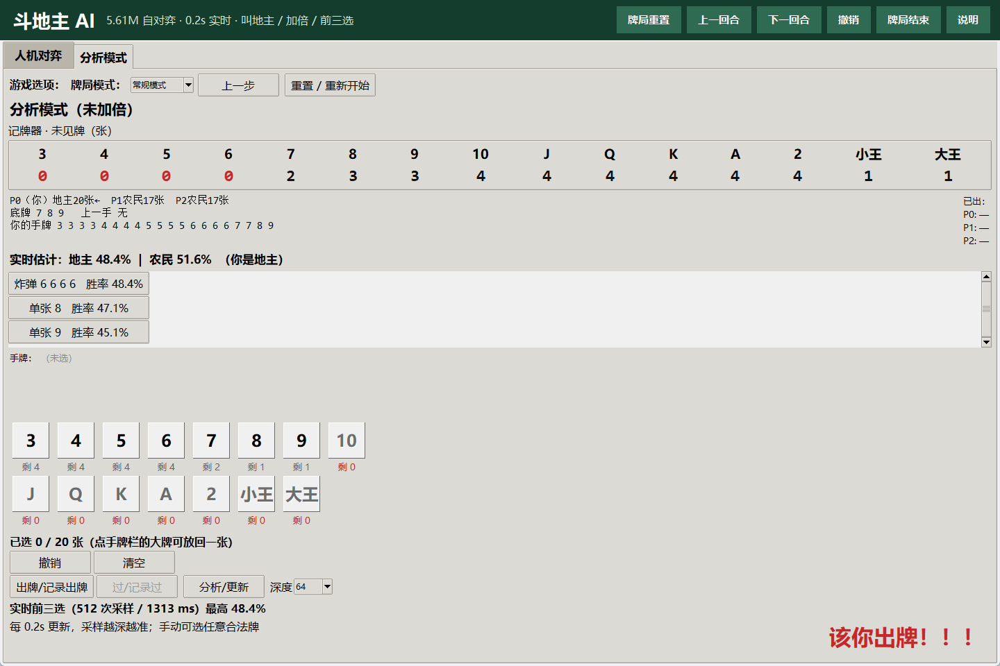
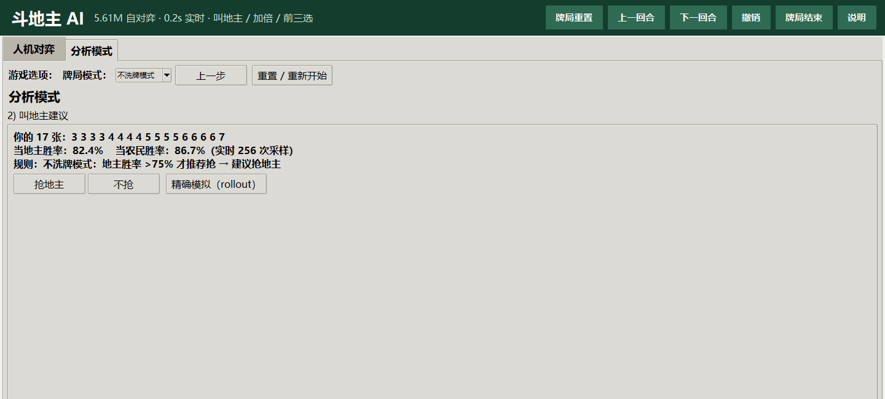

# GUI Guide

[简体中文](GUI.md) | [English](GUI_EN.md)

```powershell
python -m doudizhu.gui
```

On Windows you can also double-click `run_gui.bat`. First launch loads both models and warms up Numba/CUDA, usually 10–30 seconds.



## Top ribbon

| Button | Action |
|---|---|
| **Reset game** | Human: new deal. Analysis: return to the play phase while keeping the entered 17 cards / bottom cards. |
| **Previous turn** | Step back one action. |
| **Next turn** | Step forward after stepping back. |
| **Undo (Ctrl+Z)** | Clear current selection if any; otherwise step back. |
| **End game** | Manually stop the game/search. |
| **Help** | Quick help. |

Analysis mode also has **Reset / Restart**, which clears the 17 cards, bottom cards, seat and history.

## Analysis mode

### Mode selector

```text
牌局模式：[常规模式 ▼]  上一步  重置 / 重新开始
```

- **Regular**: default 5.61M adapter; regular bid net and regular bid rule.
- **No-shuffle**: dedicated expert `best_model_noshuffle.pt`.
  - initial bid, live bid, top-3, both-camp win rates and double advice use the expert model's own parameters;
  - the regular bid net is **not** used;
  - recommends grabbing only when landlord win rate is **> 75%**;
  - mode persists after reset / game end.



### Workflow

1. **Enter 17 cards** from high to low (jokers → 3). Right-click a rank to remove one; click a chip to remove it. Confirm.
2. **Bid advice**: show landlord/farmer win rates and recommendation. Regular rule: > farmer rate, or >70%, or at most 5% below farmer. No-shuffle: >75%.
3. **Bottom cards / seat**: choose exactly 3 remaining bottom cards; choose landlord / landlord's next / landlord's previous.
4. **Double advice**: determinization rollout; recommend doubling when own camp >70%.
5. **Play**: top-3 updates roughly every 0.2s; any legal action can be played manually; PASS only when following.

### Play screen

- Your turn badge: **“该你出牌！！！”**
- Opponent: **“该你的下家出牌”** / **“该你的上家出牌”**
- Card counter shows unseen counts; 0 is red.
- Play picker is sorted low-to-high (input pickers are high-to-low).
- The first usable top-3 appears within 1.2s; search continues to 512 samples.

## Human vs AI

Standard regular deals and the regular model. Bid/double/play as above; AI controls the other seats. The no-shuffle expert is analysis-mode only.

## Shortcuts

| Shortcut | Action |
|---|---|
| Ctrl+Z | Undo / step back |
| Ctrl+Left | Previous turn |
| Ctrl+Right | Next turn |

## Performance

On the reference RTX 5070 Ti with the 5.61M model:

```text
first result p99 136ms
64 samples  p99 672ms
128 samples p99 875ms
512 samples p99 1792ms
under 1200ms at 128 samples: 32/32
```

“99% optimal” is an engineering target, not a formal optimality proof.

## FAQ

**Why doesn't selecting cards change the total win rate?**  
Selection does not change the game state. The total updates after actual play/pass; candidate values are in the top-3 list.

**Why are input and play pickers sorted in opposite directions?**  
High-to-low is convenient for checking 17 cards/bottom cards; low-to-high matches normal play. This is intentional.

**Is the no-shuffle win rate boosted?**  
No. Displayed values are rollouts from the no-shuffle model. The >75% threshold is a decision rule, not a probability adjustment.

**Is this human-level?**  
No human evaluation has been performed. Bot results are not human win rates; see README limitations.
